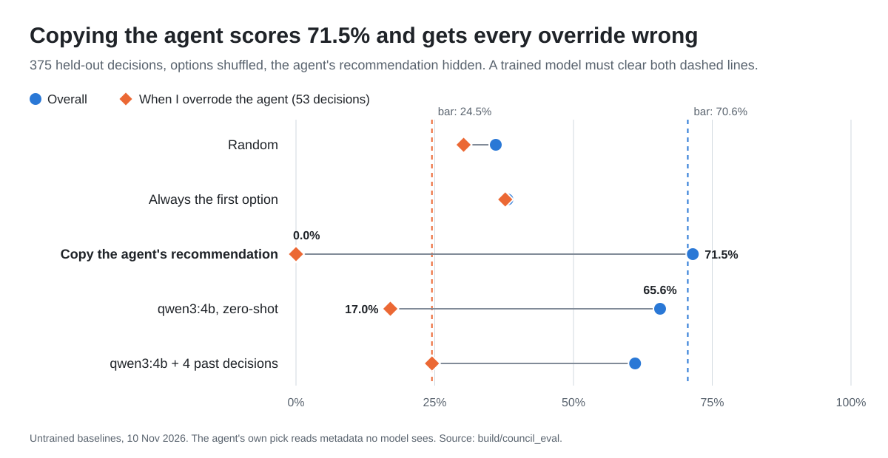
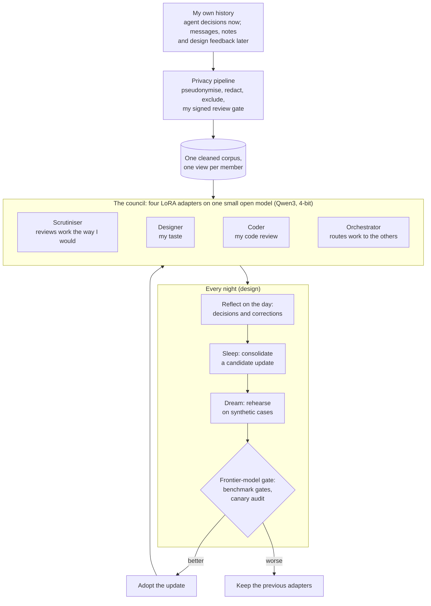

<picture>
  <source media="(max-width: 767px) and (prefers-color-scheme: dark)" srcset="assets/banner-dark-m.svg">
  <source media="(max-width: 767px)" srcset="assets/banner-light-m.svg">
  <source media="(prefers-color-scheme: dark)" srcset="assets/banner-dark.svg">
  
</picture>

[](https://github.com/Sohwhat6420/human-llm-council/actions/workflows/test.yml)
[](#status-11-november-2026)
[](LICENSE)

**The goal: an LLM that thinks and decides the way one person does, small enough to run on that person's own
laptop.**

**Why a laptop.** To learn how someone decides, a model has to train on their private history: the choices they
make, and later their messages and notes. If that needs a data centre, the history has to leave home. On
consumer-grade hardware it need not, and anyone can train their own. So far the laptop training test, on synthetic
data, fitted a 1.7-billion-parameter Qwen3 in 3.34 GB of graphics memory on a 6 GB laptop GPU, the kind in a
mid-range gaming laptop. The planned 4-billion-parameter model has not been measured on that laptop yet, and the
first real run may rent a GPU for about an hour, only with my approval.

**What it is for.** AI agents now produce more than one person can check. The aim is a council that sits between
them and me and flags what I would reject before it reaches me: on 11 November 2026 an agent showed me a preview of
a README that a newer version had already replaced, and a council that knows I always reject stale work would have
sent it back. The first member starts with a narrower job that can be measured: predict which option I pick when
an agent asks me to choose.

Each person trains their own and names it after themselves: *&lt;Your name&gt; Council*. Mine is **Ethan
Council**, and every decision count and score on this page comes from my own decisions.

> [!NOTE]
> **This is a preview.** The benchmark is built and has been run on my own decisions. No model has been trained on
> my data yet, and there is nothing to install. The [status table](#status-11-november-2026) lists exactly what
> exists.

## How it works

### The council: four small experts and one person

One small open model (Qwen3, its weights compressed to 4 bits each so it fits a laptop) carries four LoRA
adapters: thin add-on layers, each trained for one job, that share the same base model. They suggest; the person
decides.

| Member | Its job | State |
| --- | --- | --- |
| **Scrutiniser** | Reviews work the way I would and flags what I would reject | Being built first |
| **Designer** | My taste in layout and visuals | Planned |
| **Coder** | My code review | Planned |
| **Orchestrator** | Sees all of my data and routes work to the others | Planned |

### How a decision is scored

The Scrutiniser comes first because it has a clean target: when an AI agent stops and asks me to pick between
options, predict which one I pick, then check against what I really chose.

- **The test set is my real decisions.** 1,887 times between 2 July and 10 November 2026, a Claude Code agent asked
  me a single-choice question (those sessions ran on Anthropic's cloud models; everything the council does with
  the transcripts afterwards runs locally). A model learns from the earlier ones and is tested on the **latest 375** (3 to 10
  November), so the test asks it to predict my next decisions, not ones it has already seen.
- **The test is blind.** Agents often mark one option as "recommended", and I usually take it. The benchmark hides
  that mark and shuffles the options, so a model cannot score by spotting it.
- **What counts most is when I say no.** In 292 of the 375 test decisions the agent had recommended an option. I
  took it 239 times and **overrode it 53 times**. Copying the agent (and taking the first option when it
  recommends nothing) would match 71.5% of all 375, but none of those 53.

**Where it stands.** The best model so far is untrained: qwen3:4b, run as it comes on a laptop GPU. It matched my
choice on **65.6%** of the 375 decisions, about two in three; chance, averaged over how many options each
question had, is 39.8%. On the 53 overrides it got **9 right (17.0%)**.

**The bar a trained Scrutiniser must clear**, fixed after the untrained runs and before any training:

- **At least 70.6% of the 375:** five points above the best untrained model, and a statistically significant gain
  on a McNemar test. It sits below copying's 71.5% because copying reads a mark the model never sees.
- **At least 13 of the 53 overrides (24.5%):** what qwen3:4b reached when shown similar past decisions. 53 is a
  small number, so this floor guards against a model that merely imitates the agent; it is not proof of skill.
- **No new weaknesses:** at most five points lost when I take the recommendation, at most 1% unanswered, and no
  sign that it memorised training rows.

<picture>
  <source media="(prefers-color-scheme: dark)" srcset="docs/img/held-out-dark.svg">
  
</picture>

<details>
<summary><b>Full held-out results</b> (375 decisions, options shuffled, recommendation hidden)</summary>

| Setup | Matched me, all 375 | When I took the recommendation (239) | When I overrode it (53) |
| --- | --- | --- | --- |
| Random pick (one seeded draw) | 36.0% | 38.9% | 30.2% |
| Always the first option | 38.1% | 39.3% | 37.7% |
| Copy the agent's recommendation, else the first option (reads a mark the models cannot see) | 71.5% | 100% | **0%** |
| qwen3:4b zero-shot, laptop GPU | **65.6%** (95% CI 60.7 to 70.2) | 79.9% | 17.0% |
| qwen3:4b shown 4 similar past decisions | 61.1% | 72.4% | 24.5% |

The two right-hand columns cover the 292 decisions where the agent marked a recommendation; the other 83 had none
to take or override. Chance, averaged over how many options each question had, is 39.8%. On unshuffled options,
"always answer option 1" scores 79.2%, which suggests agents tend to list their own pick first; that is why every
published number uses shuffled options.

</details>

### Where it is going (design)

<details>
<summary><b>The full design: data, privacy pipeline, council and nightly update loop</b></summary>



Each night the members are meant to reflect on the day, consolidate an update, rehearse it on synthetic cases and
keep it only if it scores better on held-out decisions. That loop is design only for now. The data work runs on my
laptop. The frontier models that plan and judge updates see aggregate scores and synthetic cases, never my raw data. The one planned exception: the first real training run may use a rented GPU for about an
hour, and only if I approve uploading the cleaned, pseudonymised training view.

</details>

## Quick start

The tests run on synthetic transcripts, so they need none of your data:

```bash
git clone https://github.com/Sohwhat6420/human-llm-council && cd human-llm-council/build
python -m pip install pytest && python -m pytest -q tests     # 21 tests
node --test retest/test/retest.test.mjs                       # 14 tests for the retest tool (Node 18+)
```

## Status (11 November 2026)

| Part | State | Evidence |
| --- | --- | --- |
| Research | Notes on competitors, self-improvement, architecture, data sources, hardware and prior art. They stay private until every citation is checked; an audit found some were wrong. | Private notes |
| Scrutiniser benchmark | **Built and run on my data.** 1,887 single-choice decisions (2 Jul to 10 Nov 2026) from my Claude Code sessions; 1,510 for training, 375 held out by time (3 to 10 Nov), test ids frozen by SHA-256. | [`build/council_eval/`](build/council_eval/) |
| Baselines | **Run** on the 375 held-out decisions, options shuffled, recommendation hidden. Best untrained setup: qwen3:4b zero-shot, **65.6%**. | [Results above](#how-a-decision-is-scored) |
| Privacy pipeline | Stages 0 to 5 and 7 **built and tested** for agent decisions. Message and note sources are **designed, not built**. | [docs/PRIVACY-PIPELINE.md](docs/PRIVACY-PIPELINE.md) |
| Laptop training test | **Run on synthetic data only.** Qwen3-1.7B, 4-bit QLoRA on an RTX 3060 Laptop GPU (6 GB): 27.5 min of training, peak 3.34 GB of graphics memory. Memorisation check: none of 5 planted canary rows leaked, and the same check caught all 5 when a small model was deliberately trained to memorise them. | [`build/train/`](build/train/) |
| Scrutiniser LoRA on real data | **Not started.** It waits for my own review-gate approval of the cleaned training files. | |
| Self-consistency retest | Tool **built**: a local web page that re-asks 40 held-out questions, to measure how often I agree with myself. Not taken yet. | [`build/retest/`](build/retest/) |
| Designer, Coder, Orchestrator | Design only. | |
| Nightly reflect, sleep, dream, update | Design only. | |
| Auto-answer mode | Design only. It will always show the agent's question with the council's pick preselected; it never answers silently. | [docs/PRIOR-ART.md](docs/PRIOR-ART.md) |

## What is in this repository

| Path | What it is |
| --- | --- |
| [`build/council_eval/`](build/council_eval/) | The benchmark harness, pure Python standard library: ingest of agent decisions from local transcripts, the scrubber, the time split and freeze, blind and shuffled prompts, baselines, a local Ollama predictor, the metrics and the pre-registered gates, the training view with canaries, the review sheet and the SHA-256-bound approval. |
| [`build/train/`](build/train/) | The LoRA training script (TRL, completion-only loss, QLoRA on small GPUs). It exits without a valid approval and discards an adapter that leaks a canary. Also the canary positive control and a row-length check. |
| [`build/tests/`](build/tests/) | 21 pytest tests on synthetic transcripts. |
| [`build/retest/`](build/retest/) | The self-consistency retest: a loopback-only web page and scorer, with 14 tests and a headless smoke test on synthetic fixtures. |
| [`docs/PRIVACY-PIPELINE.md`](docs/PRIVACY-PIPELINE.md) | The privacy design: hard rules, the stages, consent. |
| [`docs/PRIOR-ART.md`](docs/PRIOR-ART.md) | Prior art and the defensive publication. |
| [`assets/`](assets/), [`tools/banner/`](tools/banner/) | The banner (animated SVG; wide and phone versions, light and dark), the 1200 × 627 LinkedIn image and the 1280 × 640 social preview, and the script that builds them. |

**Not in this repository, by design:** any data, transcript, export, corpus, review sheet, adapter or
weights; the research notes; and every name other than mine. The code reads its private settings (alias
table, HMAC key, extra exclusions) from `build/local/`, which git ignores.

## Prior art / defensive publication (11 November 2026)

This builds on earlier work, and says so: agents that simulate individuals (Park et al. 2024), a model that learns
a user's permission decisions (Wu et al. 2025), and patents from Microsoft and Meta on predicting user responses. A
model of one person that answers for them is not new.

To my knowledge no public benchmark scores a user-proxy on the cases where the user overrode the agent. Two
methods are published openly here, dated 11 November 2026, so they stay free for anyone to use:
**recommendation-blind training and testing** and **the override-accuracy deployment gate**. Full
descriptions and citations: [docs/PRIOR-ART.md](docs/PRIOR-ART.md). There is no patent or patent
application on any of it.

## Security and privacy

- **Local-first.** Raw data is processed only on the owner's machine by local models. Remote models get
  schemas and synthetic examples, never rows.
- **Other people are third parties.** Names become stable HMAC tokens with role tags; rows that mention minors
  are dropped, not redacted (a keyword filter today; a local-model check is designed); a close person's words are never a training target without their consent.
- **Training is gated twice:** before (a signed approval bound to the files' SHA-256s) and after (a canary
  memorisation audit with a positive control).
- **Transcripts are untrusted text** (OWASP LLM01): the harness parses them as data and never executes or
  follows anything in them. The retest server listens on loopback only.

## Licence

Apache-2.0. See [LICENSE](LICENSE). By Ethan Soh ([Sohwhat6420](https://github.com/Sohwhat6420)). The banner's
type is Instrument Serif, Hanken Grotesk and JetBrains Mono (SIL OFL 1.1, licences in
[`tools/banner/fonts/`](tools/banner/fonts/)).
